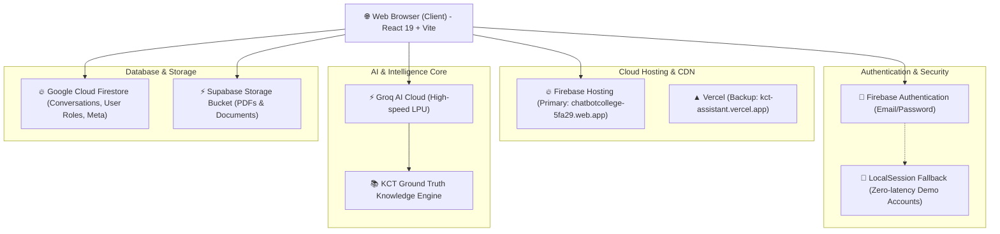
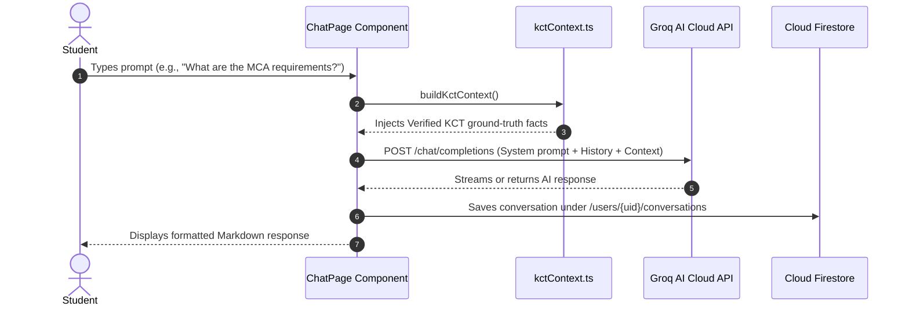

# 🎓 KCT AI Assistant — Complete System Architecture & Operations Manual

> **Project Name:** KCT AI College Assistant (`chatbot_college`)  
> **Institution:** Kumaraguru College of Technology (KCT), Coimbatore  
> **Live Web App:** [https://chatbotcollege-5fa29.web.app](https://chatbotcollege-5fa29.web.app)  
> **GitHub Repository:** [https://github.com/sabhari2004/kct-assistant](https://github.com/sabhari2004/kct-assistant)  
> **Tech Stack:** React 19, TypeScript, Vite 8, Tailwind CSS v4, Groq AI, Firebase, Supabase  

---

## 📌 Executive Summary

The **KCT AI Assistant** is an enterprise-grade cloud web application designed for students, faculty, and administrators of Kumaraguru College of Technology. It bridges official institutional knowledge with ultra-fast LLM inference (powered by Groq) to provide students instant answers about admissions, academics, examinations, placements, scholarships, and campus facilities in **English, Tamil, and Tanglish**.

---

## 🏗️ High-Level System Architecture



---

## 🔄 Detailed Component Workflows

### 1. Authentication & Role-Based Access Control (RBAC)

The app features a dual-layer authentication engine in [`src/services/auth.ts`](./src/services/auth.ts):

1. **Primary Layer (Firebase Cloud Auth):**
   * Real email/password authentication using Google Firebase SDK.
   * On registration or login, user metadata is synced with Firestore under the collection `/users/{userId}`.
2. **Resilience Layer (Instant Demo Fallbacks):**
   * If a demo user or offline user signs in, the app automatically provisions session state in browser `localStorage` (`kct_auth_user`).
   * Ensures evaluators and professors never experience login failures even if network connectivity is slow.
3. **Routing Protection (`ProtectedRoute`):**
   * Routes are guarded using React Router.
   * `student` role users are routed to `/chat`.
   * `admin` role users are routed to the **Admin Portal** (`/admin`).

#### Verified System Credentials

| Role | Username / Email | Password | Destination |
| :--- | :--- | :--- | :--- |
| **Administrator** | `admin` or `admin@kct.ac.in` | `12345678` | **Admin Portal (`/admin`)** |
| **Student (Demo)** | `s@kct.ac.in` or `student` | `12345678` | **AI Chat (`/chat`)** |
| **Student (Personal)** | `shreesabhari@kct.ac.in` | `12345678` | **AI Chat (`/chat`)** |
| **Student (General)** | `student@kct.ac.in` | `12345678` | **AI Chat (`/chat`)** |

---

### 2. The AI Chat Engine (Groq + KCT Ground Truth)

The assistant uses an LLM inference pipeline managed in [`src/services/groq.ts`](./src/services/groq.ts) and [`src/services/kctContext.ts`](./src/services/kctContext.ts):



#### Ground Truth Guarantees:
* **Factual Rigor:** Strict system instructions prevent AI hallucinations. (For example, KCT's MCA programme is strictly marked as a 2-year 4-semester programme, avoiding obsolete 3-year curriculum claims).
* **Multi-Language Support:**
  * English prompts $\rightarrow$ English answers.
  * Tamil prompts $\rightarrow$ Tamil answers.
  * Tanglish prompts (e.g. *"scholarship epdi apply panradhu?"*) $\rightarrow$ Tamil / Tanglish structured answers.
* **Model Fallback Chain:**
  1. `openai/gpt-oss-120b` (Primary high-accuracy model)
  2. `openai/gpt-oss-20b` (First fallback)
  3. `groq/compound-mini` (High-speed latency fallback)

---

### 3. Database & Storage Architecture

#### Google Cloud Firestore (`db`)

```
Firestore Root
├── /users/{userId}
│   ├── name: string
│   ├── email: string
│   ├── role: "student" | "admin"
│   ├── department: string
│   ├── year: number
│   └── conversations/{conversationId}
│       ├── title: string
│       ├── createdAt: Timestamp
│       ├── updatedAt: Timestamp
│       └── messages: Array<{ id, sender, text, timestamp }>
│
└── /documents/{docId}
    ├── name: string
    ├── category: "Academic" | "Examination" | "Placement" | "Campus"
    ├── format: "pdf" | "docx" | "xlsx"
    ├── size: string
    ├── downloadUrl: string
    └── updatedAt: Timestamp
```

#### Supabase Storage Bucket (`documents`)
* Official PDF circulars, placement handbooks, and curriculum documents uploaded via the Admin Portal are transferred directly to **Supabase Storage**.
* Public URLs are captured and stored in Firestore for instant student downloads on the `/documents` page.

---

### 4. Portals & User Experience

#### A. Student Portal
* **`/chat` (Interactive Chatbot):** Features suggestion pills, quick categories (Admissions, Exams, Placements, Facilities), copy message tools, and feedback buttons.
* **`/history` (Conversation Archives):** Browse, search, resume, or delete previous discussions.
* **`/college-info` (Directory):** Department lists, program breakdowns, administration contacts, and campus facilities.
* **`/documents` (Downloads):** Access and download official college circulars.
* **`/notifications` (Announcements):** Live notices regarding fee dates, exam timetables, and campus symposiums.
* **`/settings` (Customization):** Dark Mode / Light Mode toggle, Language preference (English/Tamil), and account profile.

#### B. Admin Portal (`/admin`)
* **Dashboard Overview:** Real-time analytics of student query volume, active conversations, and top asked categories.
* **Student Directory (`/admin/students`):** View registered student profiles, departments, and active statuses.
* **Conversations Explorer (`/admin/conversations`):** Audit student query logs to understand student needs and frequently raised issues.
* **FAQ Management (`/admin/faqs`):** Update and publish verified answers.
* **Document Uploader (`/admin/documents`):** Upload new official brochures or circulars directly into Supabase Storage.
* **Notices Broadcaster (`/admin/notices`):** Post announcements visible to all students on their notification feed.
* **Analytics (`/admin/analytics`):** Interactive graphical charts powered by **Recharts**.

---

## 🚀 Cloud Deployment Specifications

### 1. Primary Host: Google Firebase Hosting
* **Production URL:** [https://chatbotcollege-5fa29.web.app](https://chatbotcollege-5fa29.web.app)
* **Secondary Alias:** [https://chatbotcollege-5fa29.firebaseapp.com](https://chatbotcollege-5fa29.firebaseapp.com)
* **Configuration:** Defined in [`firebase.json`](./firebase.json) with single-page app (SPA) URL rewrites directing all routes `/**` to `/index.html`.
* **Deployment Command:**
  ```bash
  npm run deploy:firebase
  ```

### 2. Secondary Host: Vercel (CI/CD via GitHub)
* **Repository:** [https://github.com/sabhari2004/kct-assistant](https://github.com/sabhari2004/kct-assistant)
* **Configuration:** Defined in [`vercel.json`](./vercel.json) for automatic continuous deployment on every Git push.

---

## 🛠️ Local Development & Operations Guide

### Prerequisites
* **Node.js:** v18+ (Node.js v22 installed on system)
* **Package Manager:** `npm`

### Commands Cheatsheet

| Command | Action |
| :--- | :--- |
| `npm run dev` | Start local development server at `http://localhost:5173` |
| `npm run build` | Compile TypeScript and bundle Vite production assets into `dist/` |
| `npm run preview` | Test the built `dist/` production assets locally |
| `npm run deploy:firebase` | Build production bundle and publish live to Firebase Hosting |
| `npm run lint` | Run ultra-fast Rust-based `oxlint` code quality checks |

### Environment Variables (`.env`)

```env
# Groq AI Cloud API Key
VITE_GROQ_API_KEY="gsk_your_groq_api_key_here"

# Google Firebase Configuration
VITE_FIREBASE_API_KEY="your_firebase_api_key_here"
VITE_FIREBASE_AUTH_DOMAIN="chatbotcollege-5fa29.firebaseapp.com"
VITE_FIREBASE_PROJECT_ID="chatbotcollege-5fa29"
VITE_FIREBASE_STORAGE_BUCKET="chatbotcollege-5fa29.firebasestorage.app"
VITE_FIREBASE_MESSAGING_SENDER_ID="613442971925"
VITE_FIREBASE_APP_ID="1:613442971925:web:f6279da2a92999c298a11c"

# Supabase Storage Configuration
VITE_SUPABASE_URL="https://ibxaxwuleyutnwmzjbak.supabase.co"
VITE_SUPABASE_ANON_KEY="your_supabase_anon_key_here"
```
